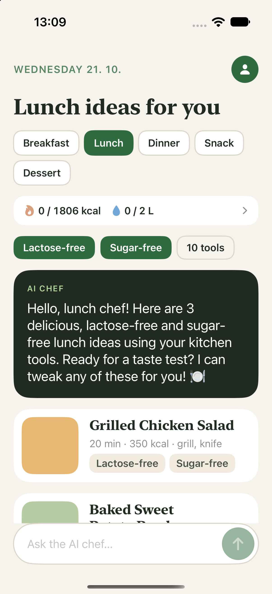
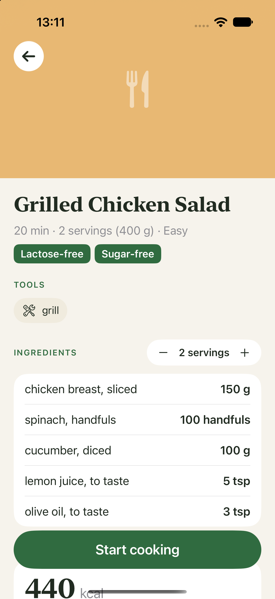
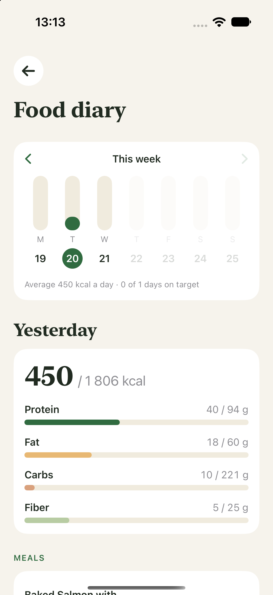
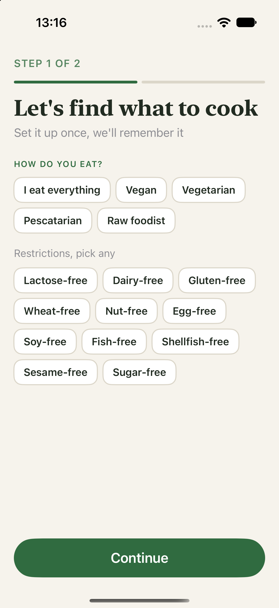
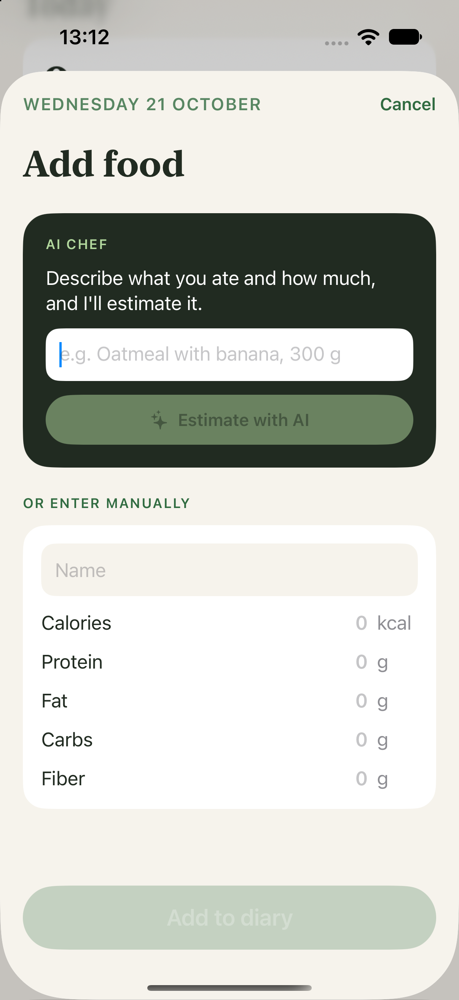
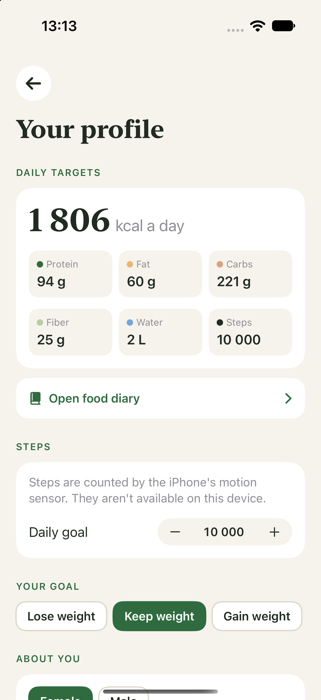

# Healthy Recipes & Tracking

An iOS app that suggests recipes you can actually cook today — based on how you eat, what's in your kitchen and the time of day — and helps you track calories, macros, water and steps.

All AI runs **on the device** with Apple Intelligence, so there are no accounts, no servers and no API keys.

  
  
  

  
  
  

## Features

**Recipes from an AI chef**
- One-time setup: diet (vegan, vegetarian, pescatarian…), restrictions (lactose-free, gluten-free, nut-free…) and the appliances and cookware you own.
- The home screen shows ideas for the current meal — breakfast, lunch or dinner is picked from the time of day.
- Recipes stream in as the AI writes them. Quick follow-ups: *Faster*, *More protein*, *Use what I have*, or ask the chef anything.
- Full recipe screen: ingredients that scale with the number of servings, step-by-step instructions, ingredient swaps explained by the AI, and a hands-free cooking mode.

**Nutrition**
- Calories, protein, fat, carbs and fiber for every recipe, plus serving weight — all scale with servings.
- Personal daily targets calculated from age, height, weight, activity and goal (Mifflin–St Jeor formula).

**Food diary**
- Week view with calories per day, average and days on target.
- Open any past day to see or add what you ate.
- Add food manually or describe it in words and let the AI estimate the nutrition.
- Finishing cooking mode asks how many servings you ate and logs them.
- Water tracking and daily steps from the iPhone motion sensor.

## Built with

- **SwiftUI** with the Observation framework (`@Observable`)
- **Apple Foundation Models** — on-device LLM with guided generation (`@Generable`, `@Guide`) and streaming responses
- **Core Motion** (`CMPedometer`) for steps
- **UserDefaults** for preferences and the food diary
- A custom `Layout` (`FlowLayout`) for wrapping chips

## Project structure

| File | What it does |
| --- | --- |
| `MyApp.swift` | App entry: shows setup on first launch, then the home screen |
| `ContentView.swift`, `KitchenView.swift` | Two-step setup: diet and kitchen |
| `RecipesView.swift` | Home screen: recipe ideas, AI chef chat, today summary |
| `RecipeDetailView.swift` | Full recipe, nutrition, cooking mode |
| `DiaryView.swift`, `AddFoodView.swift` | Food diary and adding food |
| `ProfileView.swift`, `Health.swift`, `StepCounter.swift` | Profile, daily targets, diary storage, steps |
| `Components.swift`, `Prefs.swift` | Shared UI pieces, saved preferences, AI rules |

## Running it

Requirements:
- Xcode 26 or newer
- iOS 26 or newer
- A device with Apple Intelligence turned on (iPhone 15 Pro or newer), or the iOS Simulator on an Apple silicon Mac with Apple Intelligence enabled

Open `HealthyRecipes.xcodeproj` in Xcode, pick an iPhone simulator or your device and press **Run** (⌘R).

> Apple Intelligence currently supports a limited set of languages. The device (or Mac, for the simulator) and Siri must be set to a supported language such as English.

## Notes

Nutrition values and daily targets are AI and formula estimates, not medical advice.
